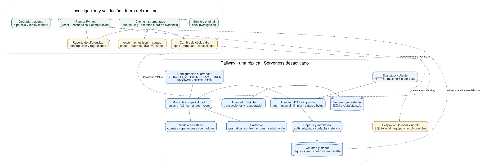

# Caja negra: diseño del reemplazo HTTP

**Estado:** diseño inicial acordado, 10 de octubre de 2026. Implementación pendiente.
**Objetivo:** reproducir el servicio vigente a la entrega, incluidos errores y memoria entre
requests. El reemplazo es autónomo, responde en menos de 5 segundos por paso y conserva
su estado tras reinicios. Este documento reúne arquitectura y especificación incremental.

## Arquitectura y decisiones



Fuente editable: [architecture.mmd](architecture.mmd). Coordinación: [PROGRESS.md](../PROGRESS.md).
Contrato: [enunciado](old-system/README.md). Plan experimental:
[estrategia de descubrimiento](research/estrategia-descubrimiento.md).

| Decisión | Razón y límite |
| --- | --- |
| Go con `net/http`, un proceso y una réplica | Experiencia del equipo, ejecución determinista y operación sencilla. No escalar horizontalmente durante el reto. |
| SQLite en volumen persistente | Mantener cuentas, operaciones y contadores sin un servidor de base de datos. Memoria solo para arranque y pruebas; no para entrega final. |
| Exploración en Python, fuera del servicio Go | Aprovechar el plan de investigación paralelo. Solo el cliente instrumentado consulta el original; el binario desplegado no contiene ese cliente ni recibe `BB_TOKEN`. |
| Railway; local + ngrok como respaldo | Una réplica, Serverless desactivado y volumen montado. Comprobar cuenta, créditos y continuidad; el respaldo requiere equipo y red disponibles. |
| Actualizaciones mediante código y redespliegue | Detectar cambios con replay manual; no autoadaptación ni consultas al original durante requests del evaluador. |
| Fidelidad antes que mejoras de negocio | Mantener typos, espacios y comportamientos observados. Documentar riesgos sin corregirlos en el reemplazo compatible. |

El único camino al original es **operador → herramienta de exploración → cliente
instrumentado → original**. El evaluador solo llega al **reemplazo → SQLite**.
La evidencia se convierte en reglas mediante revisión y cambios de código.

### Capas y dependencias

| Capa | Responsabilidad | Dependencias permitidas |
| --- | --- | --- |
| Composición (`cmd/replacement`) | Cargar configuración, abrir almacenamiento, conectar componentes y arrancar/cerrar el servidor. | Adaptador HTTP, motor y almacenamiento concreto. |
| Adaptador HTTP (`internal/httpadapter`) | Capturar método, ruta, autenticación y bytes del cuerpo; escribir status y bytes exactos. Controlar readiness y errores de transporte según evidencia. | Motor y tipos de protocolo. Sin SQL ni reglas de saldos. |
| Motor de compatibilidad (`internal/engine`) | Coordinar validaciones y comandos en el orden observado, seleccionar respuestas, ejecutar consultas/mutaciones/reset de forma indivisible. | Protocolo, modelo de estado y contrato de almacenamiento. Sin HTTP ni cliente del original. |
| Protocolo (`internal/protocol`) | Gramática de `m`, control, representación numérica, errores y serialización compatibles. No normalizar ni usar defaults del framework sin evidencia. | Biblioteca estándar. Sin base de datos ni red. |
| Modelo (`internal/state`) | Tipos de cuentas, operaciones, contadores y cambios de estado; reglas aprendidas, sin inventar restricciones bancarias. | Biblioteca estándar. |
| Persistencia (`internal/storage`) | Implementar el contrato del motor con transacciones y lecturas del estado, en SQLite o memoria. Persistir resultados completos y recuperar tras reinicio. | Modelo de estado; driver SQLite únicamente en la implementación concreta. |
| Herramientas (`tools/explorer`) | Hipótesis, sondas, secuencias, registro, replay y diferencias. Ejecución manual independiente del runtime. | Cliente HTTP instrumentado y artefactos; nunca importadas por el servicio Go. |

La interfaz de almacenamiento pertenece al consumidor del motor: debe permitir una
operación atómica que lea y modifique conjuntamente cuentas, operaciones y contadores.
Los adaptadores concretos implementan ese contrato. No dividir una transferencia en
escrituras independientes ni fijar todavía la precedencia de validaciones.

### Árbol de directorios propuesto

Los directorios de implementación siguientes son **propuestos**, no código ya creado.
El cliente `tools/explorer/bb.py` apareció durante el trabajo paralelo; se reutilizará
como única vía al original, verificando sus garantías antes de ampliar el runner.

```text
.
├── AGENTS.md
├── PROGRESS.md
├── README.md                       # uso, comandos y enlace al diseño
├── go.mod / go.sum                 # dependencias Go, al implementar
├── cmd/
│   └── replacement/main.go         # composición; único binario desplegado
├── internal/
│   ├── httpadapter/                # rutas, sobre HTTP y escritura exacta
│   ├── engine/                     # orquestación, comandos y contrato Store
│   ├── protocol/                   # parser, control, errores y respuestas
│   ├── state/                      # cuentas, operaciones y contadores
│   └── storage/
│       ├── memory/                 # desarrollo y pruebas
│       └── sqlite/                 # transacciones, esquema y migraciones
├── tools/
│   └── explorer/                   # Python; fuera del despliegue Go
│       ├── cli.py                  # baseline, replay y comparación
│       ├── bb.py                   # cliente existente; log y cuotas
│       ├── sequences.py            # reset y ejecución ordenada
│       ├── probes/                 # hipótesis, fronteras y fuzzing
│       └── compare.py              # semántica JSON y bytes/texto exactos
├── tests/
│   ├── corpus/                     # secuencias confirmadas y versionadas
│   └── differential/               # pruebas con evidencia grabada
├── docs/
│   ├── system-design.md
│   ├── architecture.mmd
│   ├── architecture.svg
│   ├── old-system/                 # enunciado y ejemplos recibidos
│   └── research/                   # estrategia e hipótesis de investigación
├── deploy/
│   └── Dockerfile                  # solo Go; configuración Railway documentada
├── scripts/                        # verificación y generación de entregables
├── experimentos.jsonl             # evidencia incremental; todavía no generado
├── artifacts/                     # diferencias y ejecuciones de replay
└── .env                           # local, ignorado; jamás incluido en imágenes
```

SQLite vive en una ruta configurable (`STATE_PATH`) dentro del volumen, por ejemplo
`/data/state.db`, no dentro de la imagen ni del repositorio. Archivos auxiliares de SQLite
deben quedar en el mismo volumen. `TEAM_TOKEN` se configura en el runtime; `BB_TOKEN`
solo en la herramienta de investigación. `.env`, archivos de estado y secretos se excluyen
de Git y del contexto de construcción.

### Estado, atomicidad y operación

Modelo inicial: cuentas (ID, datos de alta, saldo), operaciones (ID, tipo, datos necesarios
para reproducir su efecto y anulación) y contadores de IDs. Su estructura definitiva,
unidades monetarias, alcance por token y consumo de contadores se determinan con sondas.
Evitar conversiones por coma flotante; representación y rango deben reflejar el original.

Una única conexión escritora SQLite y serialización de requests con estado, incluidos
consultas y reset, proporcionan una vista consistente. Cada comando que modifica estado
confirma una transacción antes de responder; reset borra el alcance y reinicia contadores
en una transacción. El alcance exacto del reset sigue pendiente de evidencia. Un error
de validación no debe mutar estado salvo que el original demuestre lo contrario.

No prometer ejecución exactamente una vez ante cortes de red: una operación puede haberse
confirmado antes de perder la respuesta. No añadir deduplicación o reintentos de mutaciones
que alteren la semántica observada. Readiness exige almacenamiento abierto y esquema listo;
la respuesta externa de `/health` debe mantenerse compatible con el contrato observado.

## Investigación y validación

Primero reproducir los 20 ejemplos tras reset, capturar una referencia actual y comprobar
precedencia de errores. Si se puede descubrir comandos sin calcular control, aprovecharlo;
en caso contrario investigar control en tandas de hasta 100 solicitudes con hipótesis nuevas.
Después cubrir estado, anulaciones, límites, sobre HTTP y secuencias nuevas de 2-12 pasos.
La numeración de errores y los nombres bancarios orientan sondas; no prueban reglas ni
comandos adicionales.

El cliente exige hipótesis y registra **cada intento**, incluidos reset, health, rutas y
autenticación inválida. Conserva los campos del README y añade método/ruta, bytes de request
y response, timestamp, versión de corpus y etiqueta de token sin valor secreto. Un escritor
asigna IDs únicos; antes de varias herramientas concurrentes, coordinar cuota e IDs.
Un fallo de transporte se registra como intento sin respuesta y no prueba comportamiento.
Si ocurre en una secuencia con estado, abortar y repetir desde reset, sin reintento ciego.

Limitador inicial: 8 req/s, contador persistente por token/día y tope de 8.000 incluyendo
resets y reintentos. Las respuestas `X-Frontier-Infra: rate-limit` se registran como
infraestructura, se excluyen de evidencia y comparaciones y consumen presupuesto local.
Aplicar backoff; en secuencias de estado, repetir desde reset cuando sea seguro.
La caché usa el prefijo completo desde reset y la versión; se evita para confirmaciones
y detección de cambios. El log omite autorización y cualquier aparición de secretos.

### Un comando manual para detectar cambios

Interfaz prevista, **todavía no implementada**:

```sh
python3 tools/explorer/cli.py replay \
  --target original --corpus tests/corpus \
  --compare artifacts/baseline --out artifacts/current
```

La primera ejecución usa `--out artifacts/baseline` sin `--compare`. El comando valida
configuración/cuota, hace reset por secuencia, ejecuta en orden, registra intentos y produce
un informe por paso con status, cuerpo y efecto observable. Compara JSON sin convertir
números a floats ni ordenar arrays, y texto no JSON de forma exacta; además informa diferencias
de bytes para cumplir el requisito más estricto de AGENTS.md. No modifica automáticamente
la referencia, la especificación ni el servicio. Salida prevista: 0 sin diferencias, 1 con
diferencias, 2 ejecución incompleta/error; una ejecución incompleta nunca cuenta como éxito.

Tras un delta: repetir para descartar ruido, diseñar sondas mínimas, citar IDs nuevos,
añadir regresiones, cambiar Go y redesplegar conservando el volumen. Validar el corpus
anterior y el nuevo; marcar qué reglas fueron reemplazadas. No seleccionar una versión
por hora en runtime: el código final implementa la versión vigente a la entrega.

Hitos manuales: referencia antes del cambio, replay después de las 15:30 y replay final
antes de entregar. El [plan coordinado](research/estrategia-descubrimiento.md) registra Bogotá
(UTC-5): cambio 20:30 UTC / 14:30 CDMX; entrega 01:00 UTC del día siguiente / 19:00 CDMX.
Esta zona proviene del plan coordinado, no de una hora explícitamente zonificada en el README.

## Especificación incremental

**Convención:** `E1…E20` son líneas del [corpus recibido](old-system/pruebas/ejemplos.jsonl),
no IDs de `experimentos.jsonl`. No hay experimentos propios registrados en este diseño.
`probable` identifica una observación aún no repetida; `supuesto` identifica una decisión
sin prueba. Ninguna fila se declara `confirmado` hasta repetirla y citar IDs del log.
Las obligaciones del enunciado se distinguen de comportamiento observado.

### 1. Entrada

| ID | Comportamiento | Evidencia | Confianza |
| --- | --- | --- | --- |
| ENT-01 | Mensajes por `POST /msg`, cuerpo JSON con `m` string. Otros tipos y campos extra pendientes. | Contrato; E1-E20; log pendiente | probable |
| ENT-02 | El reemplazo debe exigir el token del equipo y reproducir la respuesta del original sin token o con otro token. Status y cuerpo aún desconocidos. | Contrato; sonda de auth pendiente | supuesto |
| ENT-03 | Debe exponer reset y health, y reproducir otras rutas y métodos. No asumir 404/405 del framework. | Contrato; sondas pendientes | supuesto |

### 2. Integridad

| ID | Comportamiento | Evidencia | Confianza |
| --- | --- | --- | --- |
| INT-01 | `ALTA;Lucia;83` da E202 y `ALTA;Lucia;82` crea cuenta. Fórmula y cobertura del control desconocidas. | E2-E3; log pendiente | probable |
| INT-02 | Control `5X` en el depósito observado da E201. Rango, espacios y representación pendientes. | E17; log pendiente | probable |
| INT-03 | `ALTA;Lucia;Gomez;11` da E302. No determina precedencia frente a control o comando. | E20; log pendiente | probable |

### 3. Comandos

Cada fila es el bloque inicial del comando; ampliarlo con argumentos, límites, efectos y
errores una vez medidos. No limitar la exploración a estos seis comandos.

| ID | Comportamiento | Evidencia | Confianza |
| --- | --- | --- | --- |
| CMD-PING | `PING;64` → 200, `{"pong":true}`. | E1; log pendiente | probable |
| CMD-ALTA | Alta de Lucia/Mateo → 201, `{"cuentaId":"AC-0001"}` / `AC-0002`; las cuentas observadas arrancan con saldo 0. | E3-E5; log pendiente | probable |
| CMD-CONSULTA | Consulta devuelve 200 y claves `cuenta_id`, `saldo`; `CONSULTa` funciona en ese caso. Normalización general pendiente. | E5, E8, E11, E19; log pendiente | probable |
| CMD-DEPOSITO | Depósitos observados afectan saldo y devuelven 200, `{"status":"recieved","operacionId":"OP-NNNN"}`. | E6, E18-E19; log pendiente | probable |
| CMD-TRANSFER | Transferencias observadas mueven saldo y devuelven la misma forma de operación; límites no generalizados. | E7-E11; log pendiente | probable |
| CMD-ANULA | Primera anulación: 200, `{"ok":true,"anulada":"OP-0003"}`. Repetición: 200, `{"ok":false,"motivo":"ya anulada"}`. Reversión y otros tipos pendientes. | E13-E14, E16, E19; log pendiente | probable |

### 4. Memoria entre requests

| ID | Comportamiento | Evidencia | Confianza |
| --- | --- | --- | --- |
| MEM-01 | Saldos, cuentas y operaciones afectan requests posteriores; IDs observados consecutivos. Consumo de IDs ante errores pendiente. | E3-E19; log pendiente | probable |
| MEM-02 | Reset antecede cada secuencia; deben medirse alcance, contadores y aislamiento por token. | Contrato y contexto del corpus; log pendiente | supuesto |
| MEM-03 | Persistir estado tras reinicio es una decisión del reemplazo, no una observación del ciclo de vida del original. | Decisión Q5/Q8; prueba de recuperación pendiente | supuesto |

### 5. Errores

Cuerpos exactos observados; los espacios dentro de strings son significativos. El orden de
evaluación queda pendiente: probar pares de fallos simultáneos y observar efectos en estado.

| ID | Comportamiento | Evidencia | Confianza |
| --- | --- | --- | --- |
| ERR-201 | 400, `{"error":"E201","mensaje":"control mal formado"}`. | E17; log pendiente | probable |
| ERR-202 | 400, `{"error":"E202","mensaje":"control inválido"}`. | E2; log pendiente | probable |
| ERR-301 | 400, `{"error":"E301","mensaje":"comando desconocido "}`; espacio final. | E12; log pendiente | probable |
| ERR-302 | 400, `{"error":"E302","mensaje":"aridad inválida"}`. | E20; log pendiente | probable |
| ERR-401 | 404, `{"error":"E401","mensaje":"cuenta inexistente"}`. | E15; log pendiente | probable |
| ERR-506 | 422, `{"error":"E506","mensaje":"límite excedido"}` al transferir 120000 en esa secuencia. | E9; log pendiente | probable |
| ERR-507 | 422, `{"error":"E507","mensaje":"saldo insuficiente"}` al transferir 50000 tras anulación. | E16; log pendiente | probable |

### 6. Cambios durante el día

| ID | Comportamiento | Evidencia | Confianza |
| --- | --- | --- | --- |
| CAM-01 | Se anuncia un cambio a las 15:30; la evaluación usa la versión vigente a las 20:00. No hay delta observado aún. | AGENTS.md y contrato; replay pendiente | supuesto |
| CAM-02 | Anotar versión/corpus, primer timestamp observado y IDs antes/después; sin sondeo continuo no afirmar el instante exacto del cambio. | Decisión Q6/Q10; informe pendiente | supuesto |

### 7. Riesgos

| ID | Comportamiento | Evidencia | Confianza |
| --- | --- | --- | --- |
| RIE-01 | La anulación observada no equivale a un diseño bancario seguro; investigar negativos, duplicados y operaciones inexistentes antes de describirlos. Un sistema nuevo requeriría reglas explícitas y auditoría. | E13-E16; sondas pendientes | probable |
| RIE-02 | No cambiar mensajes inconsistentes (`recieved`, claves heterogéneas, espacios) durante el reto. Un cliente nuevo usaría un contrato versionado. | E3, E5-E7, E12; log pendiente | probable |
| RIE-03 | Reinicios, volumen mal montado, cuota agotada o pérdida de red pueden hacer fallar evaluación. Verificar recuperación, persistencia y endpoint público antes de entregar. | Decisiones Q5/Q9; pruebas pendientes | supuesto |
| RIE-04 | Un fallback desconocido puede reducir puntaje. No inventar comportamiento silenciosamente: medirlo o documentar explícitamente status/cuerpo y confianza antes de implementar. | Regla del contrato; fallback aún pendiente | supuesto |

## Plan de implementación y aceptación

1. **Evidencia:** cliente instrumentado y runner; replay de referencia, auth/rutas/reset y
   precedencia. Cada comportamiento futuro cita IDs del log, sin tokens.
2. **Compatibilidad:** control y gramática, comandos y estado; conservar casos límite y
   no asumir monotonía de límites antes de aplicar búsqueda binaria.
3. **Persistencia:** SQLite y reset atómico; verificar que reiniciar conserva saldos,
   IDs y anulaciones, y que un reset restaura exactamente el estado observado.
4. **Regresión y cambio:** secuencias nuevas, errores combinados y replay manual del delta;
   pruebas locales del corpus tras cada cambio, sin usar el original en el runtime.
5. **Entrega:** Railway con volumen, smoke test público de auth/health/reset/msg/rutas
   desconocidas, latencia por paso menor de 5 s, corpus vigente y revisión del log/spec.

El diseño inicial no equivale a compatibilidad demostrada. La entrega final exige evidencia
para la especificación, pruebas de persistencia y replay público. La evaluación contiene
100 tests (40 individuales, 45 secuencias de 2-5 pasos y 15 de 6-12); reproducir solo los
20 ejemplos no garantiza puntaje alto.

Fuentes de hosting: [Railway trial](https://docs.railway.com/pricing/free-trial),
[planes y límites](https://docs.railway.com/pricing/plans),
[Serverless](https://docs.railway.com/deployments/serverless) y
[ngrok Free](https://ngrok.com/docs/pricing-limits/free-plan-limits).
